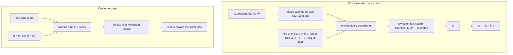

# Hilo: HiHiTech's Learned Optimizer

Hilo is a **general framework for learned matrix optimizers**. The update U of every matrix parameter W is computed
by a small matrix Transformer (the HiloNet, `Hilo.net`), and then `W ← W − lr·U`. The parameters of the HiloNet
are found by meta-training on a family of training tasks. The procedure of one training run is yours to write, as
`objective`: meta-training calls it and reads the validation loss at the end.

Hilo requires the signature `objective(net, task_seed) -> loss`, where `net` is a HiloNet and `task_seed` is a seed.
A task is this function with `task_seed` filled in, and the family is the set of these tasks. The
model, the data source, the batch size, and the number of steps stay fixed inside `objective`; the seed draws a new
weight initialization and a new data order. Hilo minimizes the average loss over the family.

| Module | Purpose |
|---|---|
| `Hilo.optimizer` | The optimizer, a `torch.optim.Optimizer` |
| `Hilo.net` / `Hilo.config` | Configurable HiloNet architecture |
| `Hilo.meta` | Meta-training (`Hilo.meta.train`) |

## Architecture

One step of `Hilo.optimizer` asks the HiloNet for an update. Meta-training changes the HiloNet parameters φ so that a full run ends at a lower validation loss. Only that final loss is used.



Row attention treats rows as tokens and column attention treats columns as tokens, so a permutation of the matrix permutes U the same way. Dividing a channel by its RMS leaves that input unchanged when the tensor is rescaled. Both runs of a pair share a task seed.

## Why learned optimizers

In [The Bitter Lesson](http://www.incompleteideas.net/IncIdeas/BitterLesson.html) (2019), Rich Sutton  argues that methods leveraging learning and compute ultimately surpass handcrafted designs. Yet neural network optimizers remain largely hand-engineered. Learned optimizers make optimization itself learnable, using neural networks trained across task families to discover update rules that improve with meta-training compute.

Hilo learns update rules from gradients, their EMAs, weights, and training progress. Its architecture encodes problem symmetries, not hand-crafted solutions, enabling shape generalization through permutation equivariance and scale invariance.

## Installation

```bash
pip install -e .                 # depends on torch only
```

## Quick start

Two steps. Meta-train a HiloNet, then train a model with it. This `objective` is linear regression on one fixed
dataset, so `task_seed` only reseeds the initial weights.

```python
import torch
from torch import nn
import torch.nn.functional as F
import Hilo
import Hilo.meta

steps, lr = 50, 1e-3
gen = torch.Generator().manual_seed(0)                   # fixed dataset
train_features = torch.randn(256, 32, generator=gen)
val_features = torch.randn(256, 32, generator=gen)
true_weight = torch.randn(32, 1, generator=gen)
train_targets = train_features @ true_weight + 0.1 * torch.randn(256, 1, generator=gen)
val_targets = val_features @ true_weight + 0.1 * torch.randn(256, 1, generator=gen)

def objective(net, task_seed):
    torch.manual_seed(task_seed)
    model = nn.Linear(32, 1)
    mats, rest = Hilo.split_params(model)                # weight matrix -> Hilo; bias -> Adam
    opt = Hilo.optimizer(mats, total_steps=steps, lr=lr, net=net)
    adam = torch.optim.Adam(rest, lr=1e-3)
    for _ in range(steps):
        F.mse_loss(model(train_features), train_targets).backward()
        opt.step()
        adam.step()
        model.zero_grad(set_to_none=True)
    with torch.no_grad():
        return F.mse_loss(model(val_features), val_targets).item()

trained = Hilo.meta.train(objective, Hilo.net(seed=0), iters=2, pairs=2, out="runs/quickstart")
print(objective(trained, task_seed=1))
```

`python examples/quickstart.py` runs this.

## modded-nanogpt example

[`examples/modded_nanogpt/`](examples/modded_nanogpt/README.md): the official baseline of modded-nanogpt Track 3
(#36, `train_gpt_simple.py`) with its hidden matrices trained by `Hilo.optimizer` (changes in
`train_gpt_hilo.diff`), plus a script that meta-trains a HiloNet on a scaled-down copy of the baseline.

## License

MIT.
